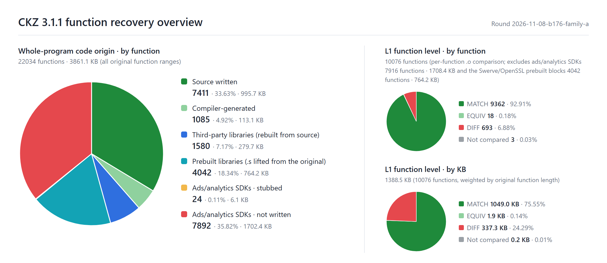

# Contract Killer: Zombies Reverse

**English** | [中文](README_CN.md)

## Overview

This project is based on `zombsniper` (armv7 Mach-O), the main executable of the iOS 3.1.1 release of Glu Mobile's *Contract Killer: Zombies*. The original binary was not stripped and still carries a complete STABS debug map: the source path and object file name of all 832 compilation units, the unit each function belongs to, and the original link order are all on record. The source tree layout, the file boundaries and the function order are all restored from that map.

The goal is a **1:1 source reconstruction**: compiling the recovered source with the original toolchain should produce a `zombsniper` that is byte-identical to the original. Fixing the game's own bugs is out of scope; original behavior, including original bugs, is kept as is.

Later fixes and ports are only worth doing on top of source that can be trusted to this degree.

The PC remake built on this source is on the [`port_PC` branch](https://github.com/Feiyang0102sso/contract-killer-zombie-re/tree/port_PC).

## Compiler, SDK and third-party libraries

The original binary carries no record of the compiler version. The versions below are inferred from per-function machine code comparison, the build paths in the debug map, and version strings inside the binary.

> ✅ Aligned　⚠️ Same version, but one aspect cannot be fully verified　❓ Original version undetermined

### Toolchain

| Component | Original | This project | Aligned | Notes |
| --- | --- | --- | :---: | --- |
| Compiler | Apple clang 3.0 | clang-211.12 (shipped with Xcode 4.2.1 4D502) | ⚠️ | Determined from code generation: 211.10.1, the version buildable from public source, emits extra `vorr` instructions and splits `vpop`; with 211.12 all of these differences disappear |
| Assembler | cctools as | cctools-809 (the external `as` of the same Xcode; clang runs with `-no-integrated-as`) | ⚠️ | Determined from encodings: in IT blocks the original always uses the T1 encoding for low-register `add`, while clang's integrated assembler only emits T2; switching to the external `as` turned 13 Glu functions and 12 third-party functions into matches, with no regressions |
| Linker | ld64 | ld64-127.2 (same Xcode) | ⚠️ | Header flags and the order and weak loading of the 32 dylibs match the original; the whole file is not byte-identical yet |
| iOS SDK | — | iPhoneOS 5.0 SDK (same Xcode) | ⚠️ | `-miphoneos-version-min=4.0` |
| Compiler flags | — | `-Os -g -fno-strict-aliasing -fvisibility=hidden`<br>C++: `-fno-rtti -fno-exceptions`<br>Objective-C++: `-fno-rtti` | ✅ | Derived from byte-identical functions; every Glu symbol in the original is private extern, which proves `-fvisibility=hidden` was on |
| Build path | `/Applications/buildAgent/work/c426877c688cbe05/` | Same (bind mount) | ✅ | `__FILE__` strings and the compilation directory in the debug info are identical to the original |

The clang, as and ld of Xcode 4.2.1 are x86_64 Mach-O programs. This project runs them directly on Linux through [maloader](https://github.com/shinh/maloader) with 3 patches applied; see `toolchain/patches/maloader.patch`.

### Third-party libraries

"Function comparison" below is the result of comparing each function against the original (match / mismatch).

| Library | Version | Source | Function comparison | Notes |
| --- | --- | --- | --- | --- |
| Lua | 5.1.4 | Official source + Glu customizations | 449 / 26 | 1 more is equivalent; compiled as C++, `lua_Number = float`; only 5 standard libraries enabled, as in the original |
| LuaBridge | 0.2 | Official source + Glu changes | 184 / 1 | |
| TinyXML | 2.5 | Official source | 120 / 14 | |
| libjpeg | 6b | Official source + Glu customizations | 150 / 2 | |
| libpng | 1.2.41 | Official source + Glu customizations | 96 / 9 | |
| libogg | 1.1.3 | Official source | 28 / 1 | |
| libvorbis | 1.2.0 | Official source + Glu private patches | 128 / 5 | |
| zlib (inflate) | 1.2.3 | Official source | 12 / 0 | The original only compiled in the inflate part |
| Facebook iOS SDK | commit `91f25642` | Official source | 155 / 0 | |
| ASIHTTPRequest | commit `331e21f` | Official source | 140 / 1 | |
| Reachability | 2.2 | Apple sample code + Glu private patches | 12 / 0 | |
| Swerve port layer (`malij297_*`) | — | Recovered from machine code | 53 / 7 | No public source |
| Swerve engine core | — | **Assembly lifted from the original binary** | Byte-identical | A symbol-less prebuilt library in the original (420,049 bytes); see below |
| OpenSSL | 1.0.0a–d | **Assembly lifted from the original binary** | Byte-identical | A prebuilt library compiled with llvm-gcc-4.2 in the original (577,912 bytes) |
| AdMarvel, Flurry, PlayHaven, Tapjoy | — | Stubs | — | Ads/analytics SDKs; **not original code**, present only so the game links and runs; in `CKZ_source/stubs/ads/` |

The Swerve engine core and OpenSSL are prebuilt static libraries in the original. They live as assembly source in `CKZ_source/packages/{swerve,openssl}/code/cocoa/libs/*_core.s` and are byte-identical to the original once relocated to their original addresses.

## Results



All code except the ads SDKs has been written, and 92.91% of the functions are identical to the original. Measured in bytes, 75.55% of the bytes are identical to the original.

For the status of every function, see the [function table](docs/function-table.en.html).

## Rebuild

The build runs on Linux. On Windows, the scripts create a dedicated WSL distribution under `.wsl\` in this repository; it takes no space on drive C and does not touch any existing WSL distribution.

### Requirements

| Item | Requirement |
| --- | --- |
| System | Windows 10 / 11 (x64) with WSL 2 enabled, or x86_64 Ubuntu 24.04 |
| WSL | If it is not installed, run `wsl --install --no-distribution` in an administrator PowerShell, then reboot |
| Xcode 4.2.1 | **Bring your own**: `installxcode_421_lion.dmg` (4D502, 1.8 GB, SHA-256 `a9bb2633…a52ef835`); downloading requires an Apple ID, see below |
| Downloaded automatically | Ubuntu 24.04 WSL image (about 350 MB), apt packages, maloader source |
| Disk | About 8 GB (the virtual disk of the WSL distribution; it does not shrink after the temporary files from unpacking the dmg are deleted) |

To download Xcode 4.2.1, sign in to Apple Developer and open this address in your browser:

```
https://developer.apple.com/services-account/download?path=/Developer_Tools/xcode_4.2.1_for_lion_21265/installxcode_421_lion.dmg
```

Use this address, because opening the More Downloads page directly redirects endlessly between a few pages. Put the downloaded file under `toolchain\xcode\`. The scripts extract only 4 component packages from it: clang, the iPhoneOS 5.0 SDK, ld and libLTO.

### Steps (Windows)

1. **Set up the environment** (once): double-click `setup.bat`. If the dmg is somewhere else, run `setup.bat <path to dmg>` from a command prompt. The script will:
   - download the Ubuntu 24.04 WSL image, check its SHA-256, and import it as the distribution `ckz-build` (disk under `.wsl\ckz-build\`);
   - install the build dependencies, then build maloader at a pinned commit and apply the patches;
   - check the SHA-256 of the dmg, extract the required Xcode components, and finally run clang, as and ld through maloader as a self-test.
2. **Build**: double-click `build.bat`. It compiles all 607 object files (about 15 seconds the first time; afterwards only changed files are recompiled) and links `zombsniper`. To recompile everything, run `build.bat -B`.
3. The output is `_output\zombsniper`, next to `zombsniper.sha256`, the link arguments `link.args` and the link log `link.log`.

The object files are reproducible: the 607 `.o` files built from the same source on different machines are byte-identical. The hash of `zombsniper`, however, changes after every recompilation, because ld64 writes each object file's modification time into the debug map (N_OSO entries).

### Steps (Linux)

On x86_64 Ubuntu 24.04 you can run the same scripts directly:

```bash
sudo bash toolchain/setup_distro.sh /path/to/installxcode_421_lion.dmg
```

```bash
sudo bash toolchain/build.sh
```

The build uses `/work` and creates the original build paths under `/Applications/buildAgent/...` and `/Developer/...` (bind mounts and symlinks), so a dedicated virtual machine or container is recommended.

### Running

You need a jailbroken iOS device. Replace `zombsniper`, the main executable, inside Contract Killer: Zombies 3.1.1.

## Layout

| Path | Contents |
| --- | --- |
| `CKZ_source/` | The recovered source, corresponding to the root of the original build machine; the relative paths of `packages/` and `src/` match the original |
| `CKZ_source/stubs/ads/` | Stubs for the ads/analytics SDKs (not original code) |
| `toolchain/` | Environment setup and build scripts, the maloader patch, and the original link order `link_order.txt` |
| `setup.bat` / `build.bat` | One-click entry points for Windows |

## Disclaimer

- This project is not affiliated with, authorized by, or endorsed by Glu Mobile or any of its affiliates.
- The names, trademarks, art, audio, levels and other game content of the Contract Killer series, as well as the original program, are the property of their respective rights holders.
- This repository contains the recovered source, the build scripts, and **the Swerve engine core and OpenSSL assembly blocks generated from the original binary**. It does not contain the original executable, the game data files, or Xcode. Running the result requires your own legally obtained copy of the game.
- This project is for study, research and preservation only and must not be used commercially.
- The code is provided "as is", without warranty of any kind; use it at your own risk.
