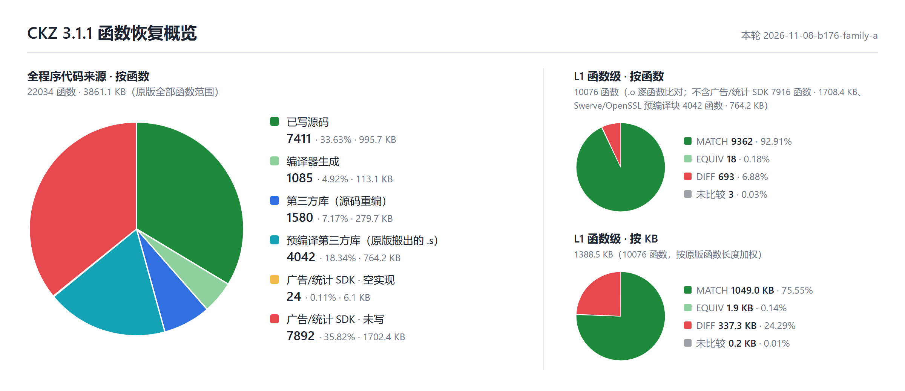

# Contract Killer: Zombies Reverse

[English](README.md) | **中文**

## 概述

本项目基于 Glu Mobile《Contract Killer: Zombies》iOS 3.1.1 版本的主程序 `zombsniper`（armv7 Mach-O）。原版程序没有剥离符号，还保留了完整的 STABS 调试映射：832 个编译单元的源文件路径、目标文件名、每个函数的归属和原版链接顺序都有据可查。源码目录结构、文件划分和函数顺序都按这份映射还原。

本项目的目标是 **1:1 还原源码**：用原版工具链编译恢复出的源码，得到与原版逐字节一致的 `zombsniper`。修复游戏原本的 bug 不在本项目范围内，原版行为（包括原版自身的 bug）一律按原样保留。

只有源码具备极高的可信度，后续的修复和移植才有实际意义。

基于这份源码的 PC 重制版见 [`port_PC` 分支](https://github.com/Feiyang0102sso/contract-killer-zombie-re/tree/port_PC)。

## 编译器、SDK 与第三方库

原版二进制里没有编译器版本记录。下表的版本依据来自逐函数的机器码比对、调试映射里的构建路径，以及二进制内的版本字符串。

> ✅ 已对齐　⚠️ 版本一致，但有一项无法完全核实　❓ 原版版本未确定

### 工具链

| 组件 | 原版 | 本项目 | 对齐 | 备注 |
| --- | --- | --- | :---: | --- |
| 编译器 | Apple clang 3.0 | clang-211.12（Xcode 4.2.1 4D502 自带） | ⚠️ | 按代码生成特征判定：公开源码能编出的 211.10.1 会多出 `vorr`、拆开 `vpop`，换用 211.12 后这些差异全部消失 |
| 汇编器 | cctools as | cctools-809（同一 Xcode 的外部 `as`，clang 加 `-no-integrated-as`） | ⚠️ | 按编码判定：IT 块里低寄存器 `add` 原版全是 T1 编码，clang 内置汇编器只出 T2；换用外部 `as` 后自家 13 个、第三方库 12 个函数变为一致，无退化 |
| 链接器 | ld64 | ld64-127.2（同一 Xcode） | ⚠️ | 文件头标志、32 个 dylib 的顺序和弱加载与原版一致；整文件尚未逐字节一致 |
| iOS SDK | — | iPhoneOS 5.0 SDK（同一 Xcode） | ⚠️ | `-miphoneos-version-min=4.0` |
| 编译参数 | — | `-Os -g -fno-strict-aliasing -fvisibility=hidden`<br>C++：`-fno-rtti -fno-exceptions`<br>Objective-C++：`-fno-rtti` | ✅ | 由逐字节一致的函数反推；原版 Glu 符号全是 private extern，可证明开了 `-fvisibility=hidden` |
| 构建路径 | `/Applications/buildAgent/work/c426877c688cbe05/` | 同左（bind mount） | ✅ | `__FILE__` 字符串和调试信息里的编译目录与原版相同 |

Xcode 4.2.1 的 clang、as 和 ld 是 x86_64 Mach-O 程序。本项目用打了 3 处补丁的 [maloader](https://github.com/shinh/maloader) 在 Linux 上直接运行它们，补丁见 `toolchain/patches/maloader.patch`。

### 第三方库

下表的“函数比对”是与原版逐函数比对的结果（一致 / 不一致）。

| 库 | 版本 | 来源 | 函数比对 | 备注 |
| --- | --- | --- | --- | --- |
| Lua | 5.1.4 | 官方源码 + Glu 定制 | 449 / 26 | 另有 1 个等价；按 C++ 编译，`lua_Number = float`；按原版只开 5 个标准库 |
| LuaBridge | 0.2 | 官方源码 + Glu 改动 | 184 / 1 | |
| TinyXML | 2.5 | 官方源码 | 120 / 14 | |
| libjpeg | 6b | 官方源码 + Glu 定制 | 150 / 2 | |
| libpng | 1.2.41 | 官方源码 + Glu 定制 | 96 / 9 | |
| libogg | 1.1.3 | 官方源码 | 28 / 1 | |
| libvorbis | 1.2.0 | 官方源码 + Glu 私改 | 128 / 5 | |
| zlib（inflate） | 1.2.3 | 官方源码 | 12 / 0 | 原版只编进了 inflate 部分 |
| Facebook iOS SDK | 提交 `91f25642` | 官方源码 | 155 / 0 | |
| ASIHTTPRequest | 提交 `331e21f` | 官方源码 | 140 / 1 | |
| Reachability | 2.2 | Apple 示例代码 + Glu 私改 | 12 / 0 | |
| Swerve 移植层（`malij297_*`） | — | 按机器码恢复 | 53 / 7 | 无公开源码 |
| Swerve 引擎核心 | — | **从原版二进制搬出的汇编** | 逐字节一致 | 原版是无符号的预编译库（420,049 字节），见下文说明 |
| OpenSSL | 1.0.0a–d | **从原版二进制搬出的汇编** | 逐字节一致 | 原版是 llvm-gcc-4.2 编的预编译库（577,912 字节） |
| AdMarvel、Flurry、PlayHaven、Tapjoy | — | 空实现 | — | 广告/统计 SDK，**不是原版代码**，只为能链接、能玩；在 `CKZ_source/stubs/ads/` |

Swerve 引擎核心和 OpenSSL 在原版里是预编译静态库。它们以汇编源码的形式放在 `CKZ_source/packages/{swerve,openssl}/code/cocoa/libs/*_core.s`，按原地址重定位后与原版逐字节相同。

## 结果



除广告SDK外的所有代码都完成编写，其中 92.91% 的函数和原版一样。若以字节为单位比较，由 75.55% 的字节与原版一样。

每个函数的状态见 [函数表](docs/function-table.cn.html)

## Rebuild

构建在 Linux 里进行。Windows 上由脚本自动创建一个专用的 WSL 发行版，放在本仓库的 `.wsl\` 目录下，不占 C 盘，也不影响已有的 WSL 发行版。

### 环境要求

| 项目 | 要求 |
| --- | --- |
| 系统 | Windows 10 / 11（x64），已启用 WSL 2；或者 x86_64 的 Ubuntu 24.04 |
| WSL | 未安装时，在管理员 PowerShell 中运行 `wsl --install --no-distribution` 后重启 |
| Xcode 4.2.1 | **需要自备**：`installxcode_421_lion.dmg`（4D502，1.8 GB，SHA-256 `a9bb2633…a52ef835`），下载需要 Apple ID，见下文 |
| 自动下载 | Ubuntu 24.04 WSL 镜像约 350 MB、apt 软件包、maloader 源码 |
| 磁盘 | 约 8 GB（WSL 发行版的虚拟磁盘；解 dmg 时的临时文件删除后，虚拟磁盘不会自动缩小） |

Xcode 4.2.1 的下载方法：登录 Apple Developer 后，在浏览器中打开

```
https://developer.apple.com/services-account/download?path=/Developer_Tools/xcode_4.2.1_for_lion_21265/installxcode_421_lion.dmg
```

直接打开 More Downloads 页面的话，它会在几个页面之间无限重定向，所以要用这个地址。下载后把文件放到 `toolchain\xcode\` 下。脚本只解出其中 4 个组件包：clang、iPhoneOS 5.0 SDK、ld 和 libLTO。

### 步骤（Windows）

1. **准备环境**（只需做一次）：双击 `setup.bat`。如果 dmg 放在别处，在命令行中运行 `setup.bat <dmg 路径>`。脚本会：
   - 下载 Ubuntu 24.04 WSL 镜像并核对 SHA-256，导入为发行版 `ckz-build`（磁盘在 `.wsl\ckz-build\`）；
   - 安装编译依赖，按固定提交编译 maloader 并打补丁；
   - 核对 dmg 的 SHA-256，解出需要的 Xcode 组件，最后用 maloader 试运行 clang、as 和 ld 做自检。
2. **构建**：双击 `build.bat`。它会编译全部 607 个目标文件（首次约 15 秒，之后只重编改动过的文件），再链接出 `zombsniper`。想全部重新编译时，运行 `build.bat -B`。
3. 产物在 `_output\zombsniper`，旁边还有 `zombsniper.sha256`、链接参数 `link.args` 和链接日志 `link.log`。

目标文件是可复现的：同一份源码在不同机器上编出的 607 个 `.o` 逐字节相同。`zombsniper` 的哈希则每次重新编译后都会变，因为 ld64 会把每个目标文件的修改时间写进调试映射（N_OSO 条目）。

### 步骤（Linux）

在 x86_64 的 Ubuntu 24.04 上可以直接运行同样的脚本：

```bash
sudo bash toolchain/setup_distro.sh /path/to/installxcode_421_lion.dmg
```

```bash
sudo bash toolchain/build.sh
```

构建会使用 `/work`，并在 `/Applications/buildAgent/...` 和 `/Developer/...` 创建原版构建路径（bind mount 和符号链接），所以建议在专用的虚拟机或容器里运行。

### 运行

需要一台越狱的 iOS 设备，替换 Contract Killer: Zombies 3.1.1中的 `zombsniper` ，及其主程序。

## 目录

| 路径 | 内容 |
| --- | --- |
| `CKZ_source/` | 恢复的源码，对应原版构建机根目录，`packages/`、`src/` 的相对路径与原版一致 |
| `CKZ_source/stubs/ads/` | 广告/统计 SDK 的空实现（不是原版代码） |
| `toolchain/` | 环境搭建与构建脚本、maloader 补丁、原版链接顺序 `link_order.txt` |
| `setup.bat` / `build.bat` | Windows 一键入口 |

## 免责声明

- 本项目与 Glu Mobile 及其关联方没有任何关系，也未获得其授权或认可。
- Contract Killer 系列的名称、商标、美术、音频、关卡等游戏内容，以及原版程序，版权均归其权利人所有。
- 本仓库包含恢复出的源码、构建脚本，以及**从原版二进制生成的 Swerve 引擎核心和 OpenSSL 汇编块**。不包含原版可执行文件、游戏数据文件和 Xcode。运行需要自备合法取得的游戏。
- 本项目仅用于学习、研究和保存目的，不得用于商业用途。
- 代码按“现状”提供，不提供任何形式的担保；使用风险自负。
